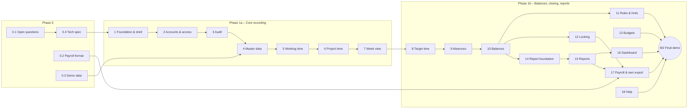

# 5. Implementation Plan

Step-by-step order for building the application. This plan only gives the **order, scope and completion criteria** of the work. Features, decisions and risks are described in docs 1–4 and are referenced here by ID (e.g. B-07, D-10, R-03) instead of being repeated.

> **Technology:** the only fixed choices are **Spring Boot** (backend) and **Angular** (frontend). The technical team decides everything else (architecture, storage, libraries, auth mechanism, build tooling) in its specification.

> **UX design is binding** (D-13): every screen is built to [06-ux-design.md](06-ux-design.md) and its mockups (light and dark). The first implementation cycle followed this plan without a design and failed the UX review; the lessons are in [06-ux-design.md §6.1](06-ux-design.md#61-why-this-document-exists-lessons-from-the-first-implementation-cycle) and are built into the steps below (marked **UX**).

> **End point of this plan:** a **locally installed demo** with the complete MVP scope (Phases 1a and 1b), presented to stakeholders using demo data. Production hosting, real data, rollout and Phase 2 come after this plan (see 5.6).

---

## 5.1 Principles

1. **Build the foundations first.** Access control, audit logging, translations and accessibility are built at the start and every later feature uses them. Adding them afterwards would mean reworking finished features.
2. **Build features end to end.** Each step delivers working features in backend and frontend that can be demonstrated and tested. Backend and frontend are not built as separate layers.
3. **Follow the dependencies.** Recording needs master data, balances need recording, reports need balances, and locking needs audit. The step order reflects this.
4. **Show it early.** Every step ends with a review by the backoffice representative, including a check against the design (see 5.2), so feedback comes in continuously.
5. **Apply the same definition of done to every step** (see 5.2).
6. **Build screens for tasks, to the approved design, from the first screen.** The shell, theme and shared building blocks come first (step 1); every later step places its features on the screens defined in [06-ux-design.md](06-ux-design.md) – never one form per feature stacked on a page.

## 5.2 Definition of Done (applies to every step)

A step is complete when, for every feature in it:

- [ ] it works end to end (backend + frontend) in the local installation,
- [ ] the demo data covers it, so it can be shown without manual preparation,
- [ ] automated tests cover the business rules (especially calculations and permissions),
- [ ] the **visibility rules (D-10)** are enforced on the server side and tested per role,
- [ ] every change to time data or admin data appears in the **audit trail** (H-01, H-02),
- [ ] all texts are available in **German and English** (D-12), including messages, emails and exports,
- [ ] it can be used in a phone-sized browser window and with the **keyboard only** (I-01, I-03),
- [ ] **UX:** its screen matches [06-ux-design.md](06-ux-design.md) and, for Today, Week and Dashboard, the mockups – in light and dark theme; it uses the shared building blocks and design tokens only (no one-off colours, spacing or fonts),
- [ ] **UX:** the screen has loading, empty and error states; dates, times and numbers are formatted per language; the figures shown are plausible for the demo data,
- [ ] **UX:** automated accessibility checks pass in light, dark, high-contrast and forced-colours mode,
- [ ] the backoffice representative has reviewed it in a demo, **including a side-by-side check against the design**.

---

## 5.3 Phase 0 – Preparation

### Step 0.1 – Clarify open business questions
**Goal:** no step is blocked by a missing business decision.

Decide and write down:
- Handling of employees exempt from working-time rules (D-01) and which rule checks apply (H-06) – with HR.
- Relationship between project time and working time: current assumption is "mismatch is only a hint" (B-14). Confirm it.
- Policies: session timeout duration, account lockout after failed logins, password rules.
- Definition of a "period" (calendar month?) and who may lock it.
- Budget warning thresholds (E-07) and who receives them (G-03).
- Source of public holidays per federal state and how holidays are maintained for each year (I-04).
- Absence types and how each one affects target time (B-15).

**Done when:** each item has a documented answer agreed by its owner (HR, backoffice, management).

### Step 0.2 – Agree the payroll export
**Goal:** the format of F-13 is fixed before reporting starts.
- Get a sample file or specification from payroll: fields, granularity, file format.

**Done when:** payroll has signed off on the format.

### Step 0.3 – Define the demo data and scenarios
**Goal:** realistic but fictitious data that shows every feature and every role.
- Fictitious users for all roles (incl. users with several roles), several teams and federal states, contract changes, opening balances.
- Projects with and without budgets, open and assigned projects, archived projects, the activity list, internal default projects.
- Test scenarios with expected results from HR (e.g. overtime balance after a month with holidays, absences and a contract change).

**Done when:** the data is available in the bulk import format (format defined in step 4) and HR has confirmed the expected results.

### Step 0.4 – Technical specification (technical team)
**Goal:** the technical team turns docs 1–5 into its specification (architecture, data model, interfaces, local setup, security concept).
- Must cover the hand-off notes in [04-roadmap.md §4.3](04-roadmap.md#43-hand-off-notes-for-the-technical-team): two kinds of time, time zones/DST/work past midnight, reproducible balances, locking and audit, soft deletion.
- **UX:** must cover how the design in [06-ux-design.md](06-ux-design.md) is built: theme and tokens (incl. warning/success/chart/hero colours), self-hosted font and icons, navigation per window size, the shared building blocks and charts, and the theme variants in the automated tests. The team reads the mockups (§6.2) before estimating.

**Done when:** the specification has been reviewed and the team has estimated the steps below.

---

## 5.4 Phase 1a – Core recording

### Step 1 – Project foundation
**Goal:** an empty but runnable application that has all cross-cutting foundations in place.
- Spring Boot backend and Angular frontend set up, with automated build and tests.
- **Local installation** that can be started with a short, documented procedure on a standard developer or demo machine.
- **UX – application shell** exactly as in [06-ux-design.md §6.3](06-ux-design.md#63-layout-the-shell): side menu with product mark and navigation groups, top bar with context line, page title, theme switch, DE/EN switch and account menu; skip link; side menu → rail → drawer per window size. Navigation entries for later steps are hidden until the feature exists.
- **UX – theme** (I-07, D-14): palette from `#0F6B67`, light, dark and high contrast, forced colours; Inter and the icon set self-hosted; all tokens from §6.5 defined once. The top-bar switch works from the start (stored per user from step 2 on).
- **UX – shared building blocks** (§6.6): page header, card, figure tile, status chip, notice card, loading/empty/error states. Charts follow in step 10.
- Translation set-up with DE/EN switching (I-02), applied from the first screen, including locale formats for dates, times and numbers.
- Accessibility baseline: keyboard navigation, focus handling, contrast, form labels (I-03). Automated accessibility checks run in all theme variants and in phone and desktop window sizes.
- Outgoing email with DE/EN templates (invitations, resets, budget warnings). In the local installation, emails are captured locally and can be viewed instead of being delivered.

**Done when:** the shell with a sample page starts from the documented local setup, matches the shell in the mockups in light and dark theme, switches between DE and EN and between themes, works as rail and drawer on smaller windows, passes the accessibility checks in every theme variant, and a test email can be viewed.

### Step 2 – Accounts, login and access control
**Features:** A-01, A-02, A-03, A-04, A-05, A-07, A-08
**Goal:** users can log in securely. Every later feature checks the user's permissions in one consistent way.
- Login, logout, session timeout, account lockout (according to the policies from 0.1).
- Invitation flow and password reset through email.
- Roles (Employee, Project Lead, Backoffice Admin, Management). A user can hold several roles.
- **One central permission check** that implements the D-10 matrix and is reused by every later feature, report and export (H-05).
- Personal settings: language, theme (System / Light / Dark, D-14), default project, preferred view, notification preferences – on the Settings page in cards (§6.4.4); the top-bar switches write to the same settings.
- **UX:** navigation groups per role exactly as in the table in [06-ux-design.md §6.3](06-ux-design.md#navigation-groups-per-role); account menu with name, Settings, My data, Sign out. The login, invitation and password-reset pages use the same theme and tokens.
- Deactivated users cannot log in.
- Create the first admin account (bootstrap).

**Done when:** each role can log in, sees only its own navigation groups, the theme and language choice survive a new login on another browser, and a deactivated user is locked out immediately.

### Step 3 – Audit foundation
**Features:** H-01, H-02 (mechanism)
**Goal:** a reusable change log exists before any business data is created.
- Record who changed what and when, including old and new values, for time entries and admin objects.
- Record when each entry was created (needed later for R-02).
- An admin screen to view the history of an object and the admin action log – **UX:** under Administration › System & audit (tab Audit log), as a table card with filters; the test e-mail form is the second tab there.

**Done when:** a change to a test object appears with user, timestamp, and old and new values.

### Step 4 – Master data administration
**Features:** U-01, U-02, U-03, U-05, U-06, U-08, E-01, E-02, E-04, E-06, E-09
**Goal:** backoffice can set up the company without technical help (G2, journeys J3, J4, J6).
- Users: create, edit, deactivate and reactivate, assign roles, team and federal state.
- Teams.
- Projects: create, edit, archive, project lead, members or "open to everyone".
- Global activity list.
- User–project assignment, from both the user side and the project side.
- Bulk import of users and projects from a spreadsheet, with validation and an error report.
- Internal default projects created and marked "open to everyone".
- Nothing is ever hard-deleted. Users are deactivated and projects are archived.
- **UX:** pages under Administration › **People** (tabs Users, Teams, Import) and › **Projects** (tabs Projects, Activities); each a table card with the main action in the page header; create/edit in a dialog or a sectioned form page (§6.4.4). No page with several unrelated forms. The project form includes the project colour (auto-assigned, optional override, D-18).

**Done when:** journeys J3, J4 and J6 work end to end and the demo data from 0.3 imports without errors.

### Step 5 – Working-time recording
**Features:** B-18, B-08, B-07 (working-day timer)
**Goal:** employees record the legal working day (D-01).
- Start, end and breaks for each day, entered manually or with "Start work / Pause / Stop".
- Correct handling of work past midnight, daylight saving time changes and multiple breaks (as specified in 0.4).
- Edit and delete until the period is locked. Locking itself comes in step 12, but the check should be prepared now (B-04, D-08).
- **UX – Today, running-day panel** ([06-ux-design.md §6.4.1](06-ux-design.md#641-today-employee-start-page), mockup `Today.dc.html`): Today becomes the employee start page (I-08). Hero panel with status chip, large timer, progress against the daily target (target comes in step 8; until then show worked time only), Take a break / End work day, and Start work day when idle.
- **UX – Day page** (§6.4.4): any date with previous/next; "Record a working day" (manual start/end/breaks) opens in a **dialog**. Timers are not repeated here.

**Done when:** an employee can record a full day by timer on Today and by manual entry on the Day page, both match the design in light and dark theme, and every change appears in the audit trail.

### Step 6 – Project time recording and day view
**Features:** B-01, B-03, B-04, B-05, B-07 (project timer), B-12
**Goal:** employees split their day across projects and activities.
- Project time entry: date, project, activity, start/end or duration, description.
- Only assigned projects and projects open to everyone can be selected. Archived projects cannot be selected.
- Project timer that creates entries automatically.
- Day view: working time, breaks and project entries with daily totals.
- **UX – Today, remaining cards from the mockup:** project-timer strip with Stop & book in the hero panel; today's timeline (work blocks, break, project blocks in project colours, now marker) with the entries table and "booked of worked" footer; quick booking with favourite chips and duration pre-filled with the unbooked time. Today loads a fixed number of data sets, never one request per entry.
- **UX:** the Day page shows the same timeline and entries table for the chosen date, with edit/delete.

**Done when:** journey J1 works on Today up to the point "sees daily total" (balances come in 1b) and Today matches `Today.dc.html` / `TodayDark.dc.html` except for the "This week" and "Things to check" cards (steps 10 and 11).

### Step 7 – Week view and fast entry
**Features:** B-02, B-09, B-10, B-16
**Goal:** a typical day can be recorded in under a minute (success criterion "Speed").
- Week grid (projects × days) with direct entry.
- Copy the previous day or week.
- Favourite and recently used projects shown first.
- Recording optimised for a phone-sized browser.
- **UX – Week timesheet** ([06-ux-design.md §6.4.2](06-ux-design.md#642-week-timesheet), mockup `Week.dc.html`): toolbar (previous/next, This week, Day | Week switch, Copy last week), figure tiles (Worked and Booked now; Target and Still open after step 10), timesheet with colour bar per row, today and weekend columns, "Copy previous day" in each day's column menu, Add project row, Booked/Worked footer rows, autosave hint; cards Add from favourites and Where the week went. On a phone the timesheet scrolls inside its card.

**Done when:** a test user records a typical day in under 1 minute, on desktop and in a phone-sized browser, and the Week page matches `Week.dc.html` / `WeekDark.dc.html` (apart from the cards that come in steps 10 and 11).

---

## 5.5 Phase 1b – Balances, closing and reports

### Step 8 – Working-time calendar and target time
**Features:** U-04, U-10, I-04
**Goal:** the system knows each user's target time for every day.
- Target hours and working days per user, with validity dates (contract changes take effect from a given date).
- Public holidays per federal state, maintained for each year.
- Opening overtime balance per user.
- **UX:** target working time under Administration › People; holidays under Administration › Month end (tab Holidays). The daily target now appears in the running-day panel on Today ("worked today · target 8:00", "2:13 to go · expected end around 16:45").

**Done when:** the target time for any past or future day can be calculated correctly for users whose contract changed or who moved between federal states.

### Step 9 – Absences
**Features:** B-15
**Goal:** vacation, sick days, holidays and other absences are recorded and counted towards target time (D-05).
- Employees mark absences themselves. Admins can mark them for others.
- Full and half days, if confirmed in 0.1.
- **UX:** Absences page under My time: calendar or list card, "Mark absence" in a dialog (§6.4.4).

**Done when:** absences affect target time exactly as agreed in 0.1.

### Step 10 – Balances and own summaries
**Features:** B-13
**Goal:** employees see target vs. actual time and their running overtime balance (D-07).
- Totals per day, week, month and project.
- Running overtime balance starting from the opening balance.
- **Balances for past periods can always be recalculated with the same result**, even after master data changes.
- **UX:** chart building blocks (§6.6) built here. "This week" card on Today (ring chart, legend, mini bar per weekday, overtime balance, Open week); Target and Still open tiles on Week; **Balance & summary** page with figure tiles, month table and totals per project (the month view, D-17). Balances are checked for plausibility against the HR scenarios before they are shown as key figures.

**Done when:** all HR test scenarios from 0.3 produce the expected balances.

### Step 11 – Rule checks and gap hints
**Features:** H-06, B-14
**Goal:** users see problems while they record (journey J2).
- Warnings for more than 10 h per day, missing breaks and rest periods shorter than 11 h (rule set from 0.1). These are warnings and do not block saving.
- Gap hints: day without entries, day below target, project time ≠ working time.
- **UX:** "Things to check" notice cards on Today and Week, each finding with an action link (Fix, Book); day status in the Week footer (✓ complete, "missing" chip). Today and Week are now complete as in the mockups.

**Done when:** each rule and hint can be triggered by a test scenario and is shown in DE and EN.

### Step 12 – Period locking and admin corrections
**Features:** C-01, C-05
**Goal:** backoffice can close a period (D-03).
- Lock a period for all users or selected users, and unlock it if needed (agreed in 0.1).
- Employees cannot change data in a locked period. Admins can still correct entries, and every correction is fully logged.
- Locks are recorded in the admin action log.
- **UX:** under Administration › Month end (tabs Close months, Corrections).

**Done when:** after a lock, an employee's change attempt is rejected and an admin correction appears in the audit trail.

### Step 13 – Hour budgets and warnings
**Features:** E-07, G-03
**Goal:** project leads and backoffice notice before a budget runs out.
- Planned hours per project (total or per month), used hours vs. planned hours.
- Warning in the app and an email when a threshold is reached (sent only once per threshold).
- **UX:** planned hours under Administration › Projects; Budgets page under Company with usage bars and status chips; the warning count appears as a badge on the Budgets menu entry.

**Done when:** crossing 80 % and 100 % produces exactly one warning each, sent to the right recipients.

### Step 14 – Reporting foundation and export
**Features:** F-04, F-05
**Goal:** one shared basis for all reports, so the reports in steps 15–16 only need configuration and layout.
- Filter and group by period, team, project, user and activity.
- Visibility rules (D-10) applied centrally to every query, report and export.
- Export to CSV and Excel for all reports. PDF for user and project reports, with DE/EN labels.
- **UX:** one reusable filter row (date range picker as one control, team and other filters) and an Export menu (CSV, Excel, PDF), as on the dashboard mockup.

**Done when:** the same filter returns different data for each role, matching the D-10 matrix, and all three export formats work.

### Step 15 – Reports
**Features:** F-02, F-03, F-06, F-07, F-09, F-12
**Goal:** all detailed reports are available.
- Project report, user report (incl. monthly working-time record as PDF), completeness report, budget report, overtime report, project lead view.
- **UX:** every report uses the report pattern (§6.4.4): page header, filter row, styled table card, export menu.

**Done when:** each report is checked against hand-calculated demo data and can only be opened by the roles allowed to see it.

### Step 16 – Dashboard and management view
**Features:** F-01, F-14
**Goal:** an overview page for backoffice and an aggregated view for management.
- Total hours, hours per project and team, weekly trend, overtime totals, missing time, projects close to their budget.
- Management view contains **no per-person data**.
- **UX** ([06-ux-design.md §6.4.3](06-ux-design.md#643-company-dashboard-backoffice-management-uses-the-same-layout), mockup `Dashboard.dc.html`): filter row with team filter, five figure tiles, hours per week (grouped bars with target line), hours by project (donut), project budgets table, completeness by team (below 90 % = warning, D-21), export menu with CSV/Excel/PDF (D-19), overtime tile as cumulative balance (D-20), donut in the projects' own colours (D-18). The Management overview uses the same layout and says "sums only, no person shown" in the top bar.

**Done when:** the management role cannot reach any per-person data, either through the UI or through exports, and the dashboard matches `Dashboard.dc.html` / `DashboardDark.dc.html`.

### Step 17 – Payroll export and own-data export
**Features:** F-13, H-03
**Goal:** the month-end close can be completed and employees can get a copy of their own data.
- Payroll export exactly in the format agreed in 0.2.
- Employees view and download all of their own records.
- **UX:** payroll export under Administration › Month end (tab Payroll export); My data page reached from the account menu (and the Insights group).

**Done when:** payroll confirms that an export generated from demo data matches the agreed format, and journey J5 (check → export → lock) takes less than 1 hour.

### Step 18 – Help and user guide
**Features:** I-05
**Goal:** users can get started without training sessions.
- In-app hints on the main screens. A short user guide in DE and EN for employees, project leads and backoffice.
- **UX:** the guide uses the screen names of the design (Today / Heute, Day / Tag, Week / Woche, …) and screenshots of the final screens.

**Done when:** someone unfamiliar with the application records a full week using only the guide.

### Step 19 – Final stakeholder demo (Milestone M2)
**Goal:** the complete MVP scope runs locally and is presented to stakeholders. **This is the end of this plan.**
- **Acceptance check** of all MVP features from [02-feature-catalog.md](02-feature-catalog.md) against the demo data, including role and visibility tests.
- **UX acceptance:** the product owner confirms the success criterion "UX" ([04-roadmap.md §4.2](04-roadmap.md#42-success-criteria)): Today, Week and Dashboard match the mockups in light and dark theme, all other screens follow [06-ux-design.md](06-ux-design.md), no accessibility violations in any theme variant.
- **Demo installation:** a fresh local installation, following the documented setup, loaded with the full demo data set.
- **Demo script** that walks through journeys J1–J6 with each role and switches between DE and EN.
- **Stakeholder demo** with backoffice, HR, payroll, project leads and management.
- Collect the feedback and decisions as input for the next stage.

**Done when:** the demo has taken place on a fresh local installation, all MVP features were shown, and the feedback is documented.

---

## 5.6 After this plan

The following topics are deliberately **not** part of this plan. They will be planned after the stakeholder demo, based on its feedback:

- Production hosting, operations, backups and monitoring.
- Security and accessibility review for productive use.
- Legal re-check (R-05) and review of the accepted risks R-01 – R-05, incl. works council and data protection officer (R-04).
- Import of real users, projects and opening balances.
- Pilot with real users, rollout, user communication and support during the first months.
- Phase 2 features (A-06, B-11, U-09, F-10, G-01).

---

## 5.7 Overview

**Possible parallel work** (with more than one developer or pair):
- Step 13 (budgets) can start as soon as step 6 is finished.
- Steps 8–9 (calendar, absences) can start alongside steps 6–7, because they only need master data.
- Step 18 (help) can be written alongside steps 14–17.
- Steps 0.2 and 0.3 (payroll format, demo data) run alongside development and must be finished before steps 17 and 4.
