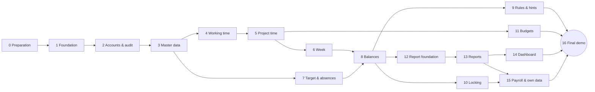

# Implementation plan – overview

Order, scope and completion criteria of the work. Each step is one file in `steps/` and is self-contained together with `context.md`. End point: the full MVP as a local stakeholder demo (step 16). Phase 1a can be piloted with a small group; go-live would follow 1b.

## Principles

1. **Foundations first:** access control, audit, translations, accessibility, shell and theme exist before features use them.
2. **End to end, screens included:** every step delivers working backend *and* screens that can be demonstrated.
3. **Follow the dependencies:** recording needs master data, balances need recording, reports need balances, locking needs audit.
4. **Screens for tasks, to the approved design, from the first screen** – never one form per feature stacked on a page.
5. **Same Definition of Done for every step** (`context.md`); every step ends with a review by the backoffice representative incl. a side-by-side design check.

## How to work a step

Each step has two parts, done in this order:

- **Part A – backend and contract:** use cases, persistence, endpoints, tests, the committed API contract.
- **Part B – screens:** the Angular screens from the step's UX files, generated client, component and E2E/a11y tests, design check light and dark.

**Part B of step N is finished before part A of step N+1 starts.** Earlier runs let the backend race ahead while screens piled up – the cycle-1 failure mode (see `background.md`). At most one step may have open screen work. Parts A and B may run in separate sessions; each reads only what its part lists under "Read".

## Steps

| # | Step | Features | Needs |
|---|------|----------|-------|
| 0 | [Preparation](steps/00-preparation.md) (business answers, payroll format, demo data, tech spec) | – | – |
| **Phase 1a – core recording** ||||
| 1 | [Foundation and shell](steps/01-foundation.md) | I-01, I-02, I-03, I-07 | 0.4 |
| 2 | [Accounts, access control, audit](steps/02-accounts-access-audit.md) | A-01–A-05, A-07, A-08, H-05, H-01, H-02 | 1 |
| 3 | [Master data](steps/03-master-data.md) | U-01–U-03, U-05, U-06, U-08, E-01, E-02, E-04, E-06, E-09 | 2, 0.3 |
| 4 | [Working time, Today hero, Day page](steps/04-working-time.md) | B-18, B-08, B-07 (day), B-04, I-08 | 3 |
| 5 | [Project time and day view](steps/05-project-time.md) | B-01, B-03, B-04, B-05, B-07 (project), B-12 | 4 |
| 6 | [Week timesheet](steps/06-week.md) | B-02, B-09, B-10, B-16 | 5 |
| **Phase 1b – balances, closing, reports** ||||
| 7 | [Target time and absences](steps/07-target-time-absences.md) | U-04, U-10, I-04, B-15 | 3 |
| 8 | [Balances and own summaries](steps/08-balances.md) | B-13 | 6, 7 |
| 9 | [Rule checks and gap hints](steps/09-rule-checks.md) | H-06, B-14 | 8 |
| 10 | [Period locking and corrections](steps/10-locking.md) | C-01, C-05 | 8 |
| 11 | [Hour budgets and warnings](steps/11-budgets.md) | E-07, G-03 | 5 |
| 12 | [Reporting foundation, export, PDF template](steps/12-reporting-foundation.md) | F-04, F-05 | 8 |
| 13 | [Reports](steps/13-reports.md) | F-02, F-03, F-06, F-07, F-09, F-12 | 12 |
| 14 | [Dashboard and management overview](steps/14-dashboard.md) | F-01, F-14 | 13 |
| 15 | [Payroll and own-data export](steps/15-exports.md) | F-13, H-03 | 10, 13, 0.2 |
| 16 | [Help, acceptance, final demo (M2)](steps/16-final-demo.md) | I-05 | all |

**Parallel work** (more than one developer or pair): 11 can start after 5; 7 can run alongside 4–6; the user guide part of 16 can be drafted alongside 12–15; 0.2 and 0.3 run alongside development and must be finished before 15 and 3.

## After this plan (not part of it)

Planned after the stakeholder demo, based on its feedback: production hosting, operations, backups, monitoring · security and accessibility review for productive use · legal re-check (R-05) and review of R-01 – R-05 incl. works council and DPO (R-04) · import of real users, projects, opening balances · pilot, rollout, communication, support · Phase 2 features (A-06, B-11, U-09, F-10, G-01).
